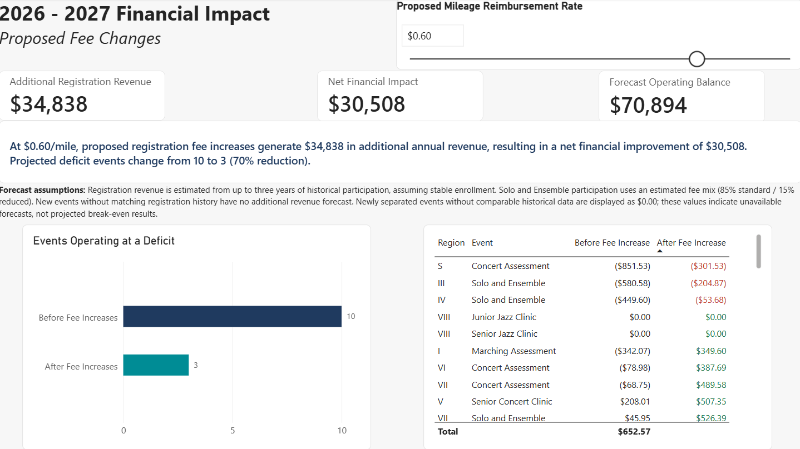
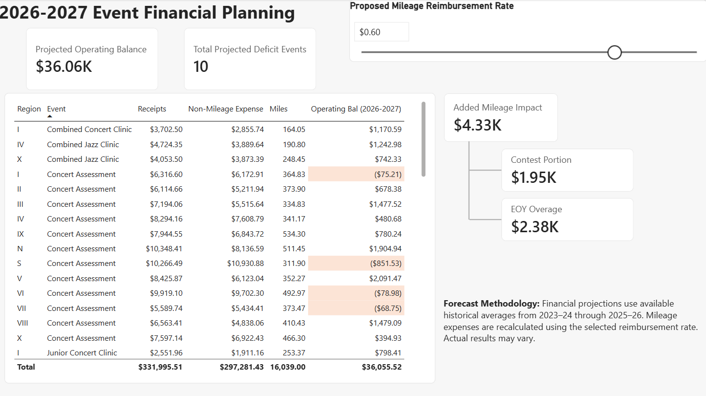
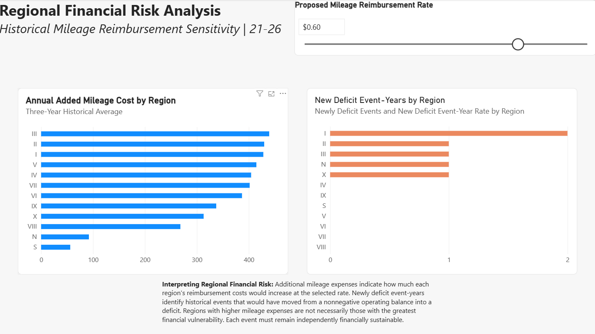
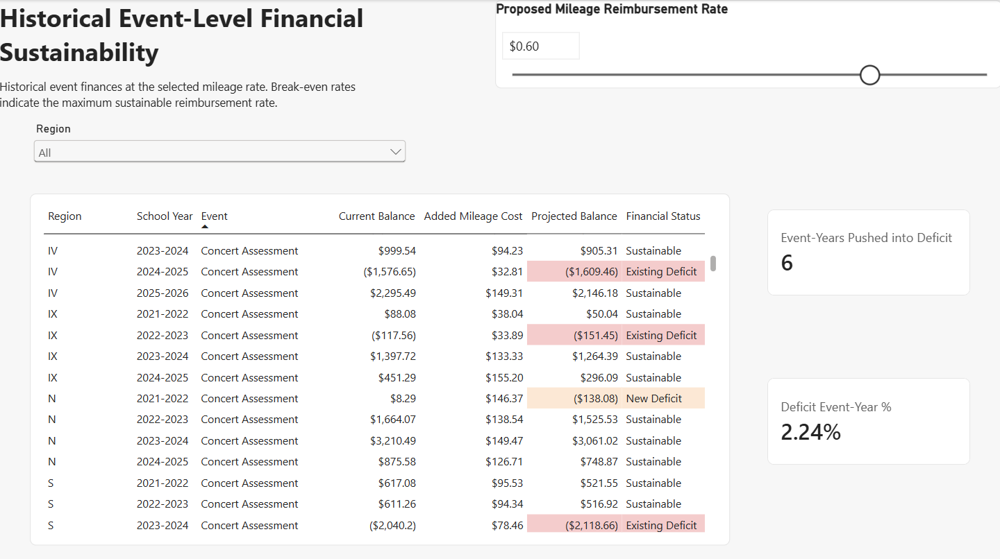

# Financial Sustainability & Scenario Analysis
### Power BI | DAX | Power Query | Financial Forecasting

## Project Overview

How can an organization increase reimbursement rates while maintaining financial sustainability across its operations?

This project demonstrates how Power BI can be used to evaluate financial policy changes, identify operational risks, and model potential solutions.

The analysis was inspired by a real-world business challenge involving mileage reimbursement expenses and event-level financial sustainability.

The initial objective was to evaluate how increasing mileage reimbursement rates would affect projected operating balances across multiple regions and events.

The analysis identified events at risk of operating at a deficit, prompting a second business question:

**Could adjustments to registration fees offset increased expenses and improve financial sustainability?**

The resulting dashboard combines historical financial analysis, forecasting, and scenario modeling to support informed financial decisions.

## Dashboard Preview



*Financial impact of proposed registration fee adjustments at a simulated $0.60/mile reimbursement rate. All financial figures are synthetic.*

**Data Privacy:** All financial data presented in this public portfolio project is synthetic. The analytical methodology was adapted from professional experience, but no actual employer financial records or results are disclosed.

---

## Business Objectives

The project addresses four primary questions:

1. How would increasing mileage reimbursement rates affect projected operating balances?
2. Which regions and events are most financially vulnerable?
3. How many historically sustainable event-years would become deficit-producing under higher reimbursement rates?
4. Could proposed registration fee increases offset additional expenses and reduce projected operating deficits?

## Tools and Technologies

**Power BI**
- Interactive dashboards and financial reporting
- Scenario modeling using a mileage reimbursement parameter
- Regional and event-level financial analysis
- Conditional formatting and risk visualization

**DAX**
- Historical averaging and forecasting measures
- Dynamic reimbursement expense calculations
- Operating balance projections
- Deficit identification and classification
- Registration revenue scenario modeling

**Power Query**
- Data preparation and transformation
- Standardization of regional identifiers
- Integration of historical financial and registration datasets

**Excel**
- Synthetic dataset preparation
- Historical financial and participation data structures

## Analytical Methodology

### 1. Historical Financial Analysis

The model evaluates historical event-level financial performance using data representing the 2021–2022 through 2025–2026 school years.

Key variables include:

- Event receipts
- Audition balance contributions
- Mileage
- Operating expenses
- Regional and event classifications

Historical data provides the foundation for evaluating reimbursement sensitivity and estimating future financial performance.

### 2. Financial Forecasting

The 2026–2027 financial planning model uses available historical averages from the three most recent school years.

Forecasts estimate:

- Event receipts
- Audition balance contributions
- Non-mileage operating expenses
- Mileage reimbursement expenses
- Projected operating balances

The model applies the selected reimbursement rate to forecast mileage, allowing users to evaluate different financial scenarios.

### 3. Mileage Reimbursement Sensitivity

An interactive parameter allows users to evaluate reimbursement rates between $0.33 and $0.69 per mile.

The analysis calculates the additional reimbursement expense associated with higher rates and identifies events that would move from a positive operating balance into a deficit.

This distinguishes newly created financial risks from deficits that already existed.

### 4. Registration Fee Scenario Analysis

The model evaluates two proposed fee adjustments:

- A $1 increase in applicable per-student registration fees.
- A $25 increase in applicable per-group assessment fees.

Projected additional revenue is estimated using historical participation and registration information.

The model then evaluates how these changes could offset higher mileage expenses and improve projected operating balances.

## Technical Implementation: DAX

The financial sustainability model uses DAX measures to combine historical forecasts, apply dynamic reimbursement rates, and evaluate proposed registration fee adjustments.

The following calculations demonstrate two core components of the analytical model.

### 1. Dynamic Financial Forecasting

The `Forecast Operating Balance (2026-2027)` measure calculates projected operating balances using historical revenue and expense estimates.

```dax
Forecast Operating Balance (2026-2027) =
VAR EstimatedReceipts =
    [Forecast Receipts (3Y Average)]
VAR EstimatedAuditionBalance =
    COALESCE([Forecast Audition Balance (3Y Average)], 0)
VAR EstimatedExpenses =
    [Forecast Non-Mileage Expenses (3Y Average)]
VAR EstimatedMiles =
    [Forecast Miles (3Y Average)]
VAR SelectedRate =
    [Mileage Rate Value]
RETURN
    EstimatedReceipts
    + EstimatedAuditionBalance
    - EstimatedExpenses
    - (EstimatedMiles * SelectedRate)
```

**Business purpose:** Estimate financial performance under different mileage reimbursement policies.

**Technical approach:**

- Reuses historical forecasting measures for receipts, audition balances, expenses, and mileage.
- Uses `COALESCE` to handle missing audition balance values.
- Incorporates a dynamic reimbursement parameter selected by the dashboard user.
- Calculates projected operating balances without requiring separate measures for each reimbursement scenario.

This approach allows decision-makers to evaluate how changing reimbursement policies could affect financial sustainability.

### 2. Registration Fee Revenue Scenario Modeling

The `Forecast Additional Registration Revenue` measure estimates additional annual revenue generated by proposed registration fee increases.

```dax
Forecast Additional Registration Revenue =
SUMX(
    '2026-2027 Event Planning',
    VAR CurrentRegion =
        '2026-2027 Event Planning'[Region]

    VAR CurrentEvent =
        '2026-2027 Event Planning'[Event]

    VAR RegistrationRegion =
        SWITCH(
            CurrentRegion,
            "N", "North Orchestra",
            "S", "South Orchestra",
            CurrentRegion
        )

    VAR HistoricalRecords =
        FILTER(
            ALL('Registration Fee Analysis'),
            'Registration Fee Analysis'[Region] = RegistrationRegion
                && 'Registration Fee Analysis'[Event] = CurrentEvent
        )

    VAR HistoricalRevenue =
        SUMX(
            HistoricalRecords,
            SWITCH(
                TRUE(),
                CurrentEvent IN {
                    "Marching Assessment",
                    "Concert Assessment"
                },
                    'Registration Fee Analysis'[# of groups] * 25,

                CurrentEvent = "Solo and Ensemble",
                    DIVIDE(
                        'Registration Fee Analysis'[Total Receipts],
                        4.975
                    ),

                'Registration Fee Analysis'[# of students]
            )
        )

    VAR YearsAvailable =
        COUNTROWS(HistoricalRecords)

    RETURN
        DIVIDE(HistoricalRevenue, YearsAvailable, 0)
)
```

**Business purpose:** Estimate whether proposed registration fee increases could offset higher mileage reimbursement expenses.

**Technical approach:**

- Iterates through planned events using `SUMX`.
- Matches each planned event to historical registration records.
- Standardizes regional identifiers using `SWITCH`.
- Applies event-specific revenue calculations:
  - $25 additional revenue per participating group for marching and concert assessments.
  - $1 additional revenue per student for applicable individual registration events.
  - Estimated additional Solo and Ensemble revenue based on historical receipts and an assumed weighted registration fee of $4.975.
- Averages calculated revenue across matching historical records.

The model assumes that each matching historical record represents one comparable event-year.

The $4.975 Solo and Ensemble estimate reflects an assumed registration mix of 85% standard registrations at $5.50 and 15% reduced registrations at $2.00.

**Analytical significance:** This calculation demonstrates how conditional business rules can be incorporated into a reusable DAX measure to evaluate financial policy scenarios.

### Technical Takeaway

Together, these measures demonstrate the use of DAX for financial forecasting, scenario modeling, conditional calculations, and business decision support.

Rather than producing static financial reports, the model allows users to explore how different reimbursement and registration fee policies could affect projected financial outcomes.

## Dashboard Pages

### 1. Event Financial Planning



Provides a forecast of event-level financial performance for the upcoming school year.

Highlights projected operating balances, deficit events, and additional mileage expenses under the selected reimbursement rate.

### 2. Regional Financial Risk Analysis



Compares additional mileage expenses across regions and identifies regions experiencing newly created deficit event-years.

Demonstrates why higher expenses do not necessarily indicate greater financial vulnerability.

### 3. Event-Level Financial Sustainability



Examines historical financial performance at the event-year level.

Classifies events as financially sustainable, already operating at a deficit, or newly pushed into a deficit by increased reimbursement expenses.

### 4. Registration Fee Impact Analysis


Evaluates the projected financial impact of proposed registration fee adjustments.

Compares operating deficits before and after fee changes and quantifies the potential improvement in financial sustainability.

## Key Findings

The following results are from a **synthetic financial scenario** using a reimbursement rate of $0.60 per mile.

| Metric | Simulated Result |
|---|---:|
| Additional annual registration revenue | $34,838 |
| Net financial improvement | $30,508 |
| Forecast operating balance after fee adjustments | $70,894 |
| Projected deficit events before fee adjustments | 10 |
| Projected deficit events after fee adjustments | 3 |
| Reduction in projected deficit events | 70% |

### Business Interpretation

The scenario demonstrates that increasing reimbursement expenses can create financial pressure across multiple events.

However, the proposed registration fee adjustments could generate sufficient additional revenue to offset the modeled increase in mileage expenses and improve the organization's projected financial position.

The analysis also highlights that organization-wide financial improvement does not guarantee sustainability for every individual event.

**Financial sustainability must be evaluated at both the organizational and event levels.**

## Assumptions and Limitations

- All public financial data is synthetic.
- Forecasts rely on available historical averages rather than predictive statistical models.
- Registration revenue projections assume relatively stable participation.
- Solo and Ensemble registration estimates use an assumed fee distribution of 85% standard registrations and 15% reduced-fee registrations.
- Some events lack sufficient comparable historical data to generate reliable forecasts.
- Where historical information is unavailable, certain dashboard calculations display $0.00; these should not be interpreted as confirmed break-even projections.
- Actual financial results may differ from modeled scenarios.

## Business Value

This project demonstrates how an analyst can move beyond reporting historical performance to support financial decision-making.

The analytical process progressed from evaluating a proposed expense increase to identifying financial vulnerabilities and modeling potential revenue adjustments.

The dashboard enables decision-makers to:

- Evaluate reimbursement policy scenarios.
- Identify financially vulnerable regions and events.
- Compare potential financial outcomes.
- Understand trade-offs between expenses and revenue.
- Make more informed financial planning decisions.

## Project Takeaway

**Effective business analytics does more than explain what happened. It helps decision-makers understand what could happen next and evaluate their options.**

This project illustrates how Power BI, DAX, and structured financial analysis can transform operational data into actionable business insights.
